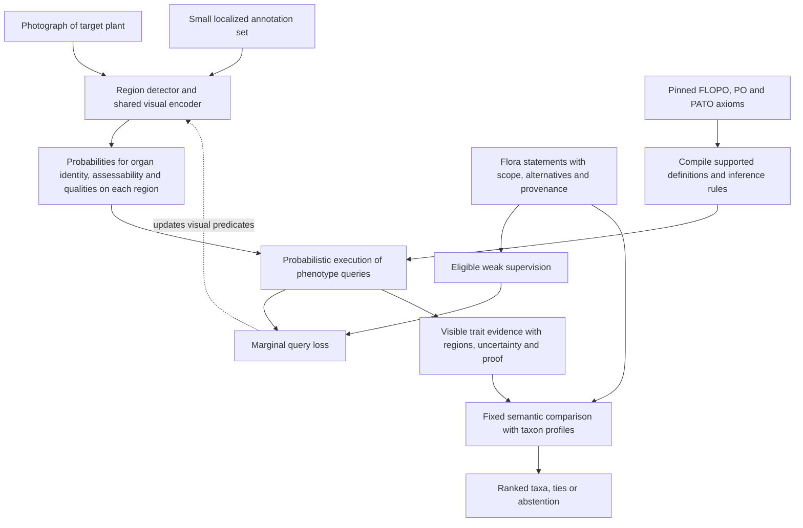

# Visually grounded FLOPO inference: architecture and experiment

**Current priority: phenotype recognition first.** Species accuracy is a secondary,
downstream outcome and must not select or validate the trait recognizer. The direct
image-level audit at the end of this document finds poor shape recognition despite
the earlier species-identification scores. Its labels are provisional AI visual
reviews, not expert ground truth. See [trait-only results](flopo-trait-evaluation.json).

**Approved plan, architecture updated 25 October 2026:**
[Learning visual traits from taxon labels](#learning-visual-traits-from-taxon-labels-plan-25-october-2026)
supersedes the species-likelihood-first training recommendation. The subsequent
[2025–2026 architecture update](#architecture-update-modern-methods-20252026)
replaces APN as the main architectural starting point with modern region-level
foundation features and class-prior concept learning. The approved data design,
weak supervision, FLOPO constraints and direct trait evaluation remain in force.
The larger experiments described in these sections have not run.

**Implementation status:** the [modern experiment record](flopo-modern-run.json)
tracks the implemented encoders, weak trait learner, collected cohort and Orix
submission state. The independent trait review packet is initially unannotated;
the existing AI audit remains development evidence.

Design decision, 24 October 2026. This replaces the recommendation to transplant
DeepGO-SE into the image task. It is a proposed architecture and preregistration outline,
followed by records of the subsequent experiments. The website and deployed data are unchanged.

**25 October revision:** the section “Latent traits trained through taxon WMC”
supersedes the initial prohibition on species-loss gradients for the next experiment.
The frozen scorer below remains a baseline and describes the completed v1/v2 runs.
DeepLog 5 is the first compilation backend for the new branch. The tested prototype
establishes inference and gradient semantics, not improved plant recognition.

## 1. What the architecture must solve

The observation is a photograph, the biological object is a specimen with organs, and the
weak annotation describes a taxon in a flora. These are three different levels. A species
described as having yellow petals can be photographed without flowers, with flowers at a
different stage, or beside another yellow-flowered plant. A correct species prediction can
therefore produce an incorrect claim about the image.

A direct DeepGO-SE adaptation does not supply organ localization, bind qualities to their
bearers, establish visibility, or identify which specimen the source statement applies to.
Those are inference variables, not merely missing ontology-embedding dimensions. Moreover,
ordinary flora statements are not universal, exception-free axioms about every photographed
individual. Making them hard axioms would create false certainty.

**Decision:** learn grounded visual predicates, execute supported FLOPO definitions over
them, and train the predicates through the probability of eligible source statements.
Keep taxon identification downstream of this visual evidence. Use an exact symbolic
executor for a declared fragment; do not ask geometric proximity to stand in for the
meaning of a phenotype expression.

This is feasible because the repository already represents an EQ phenotype as
`has_part some (E and has_quality some Q)` in `flopo2/owl/build.py`. Annotation expressions
also retain alternatives, negation and nested part restrictions. Those richer expressions
need an explicit support audit; their presence does not make all of them visually learnable.

## 2. Architecture



### A. Region-level visual predicates

Start with leaves, petals and fruits. Predict colour, outline, margin and surface qualities
only where the organ and attribute are applicable and visually assessable. Audit the exact
vocabulary before fixing it: flower and petal are different bearers, and a distant flower
image may support colour but not hairiness. Absolute size without scale, odour, physiology,
life span and seasonality are excluded from direct visual claims.

Use a fixed, version-pinned biological vision encoder, initially frozen, with an organ-region
detector and small shared attribute heads. Every comparison receives the same proposals,
encoder, crops and annotation budget. Later fine-tuning is a separate, matched experiment.
The organ detector needs a small set of boxes/masks and a target-plant/background label.
Whole-image context may help propose regions; the primary quality heads consume the
localized region. Background-only and context-removal tests check this boundary.

Each region carries:

| Variable | Meaning |
|---|---|
| Target ownership | This region belongs to the plant being described, rather than a neighbour |
| Organ identity | Distribution over supported anatomical types, including other/uncertain |
| Attribute assessability | Whether this view supports assessing colour, outline, surface, etc. |
| Attribute state | Conditional distribution or multi-label prediction for a specific attribute |
| Provenance | Image, region, scale and stage information when available |

Attribute states are conditional on organ identity; they are not independent image-level
predictions. Share a quality predictor across applicable bearers while permitting visual
differences between organs. Use categorical states only where the annotation protocol
establishes an exhaustive, exclusive partition. Multicoloured organs and overlapping shape
terms require multi-label states. Do not invent disjointness because labels sound different.

Assessability is distinct from confidence in a particular state. Train and calibrate it using
localized annotations; freeze it during the initial weak-supervision phase. A blurred leaf
can be confidently detected while its margin remains unassessable. Low probability of
"serrated" must not automatically become evidence for "entire".

### B. A grounded graph and an ontology compiler

Represent target specimen `s`, organ regions `r`, and quality states with stable identities.
Preserve the witness of each existential restriction and the scope of each conjunction.
The actual ontology uses `BFO:0000051` for has-part and `RO:0000053` for has-quality.

For example, a query for an observed yellow leaf has the form:

```text
exists r, q:
    observed_part_of_target(r, s)
    AND leaf(r)
    AND has_quality(r, q)
    AND yellow(q)
    AND colour_assessable(r)
```

`colour_assessable` and observed target ownership are evidence conditions, not new
biological axioms. They control when a visual observation can support the FLOPO expression.

The crucial distinction is:

```text
exists r: leaf(r) AND yellow(r)       # one leaf bearing yellow
(exists r: leaf(r)) AND
(exists u: yellow(u))                # could be a green leaf and a yellow petal
```

The abbreviated `yellow(r)` means that the organ bears a yellow quality. The implemented
compiler must retain quality witnesses too when an expression requires them. Two separate
existentials must not be rewritten as a conjunction with a shared witness, or vice versa.

Compile named-class subsumption, equivalent-class definitions, supported conjunctions and
existential restrictions into a small, typed query program. Include source alternatives as
explicit allowed alternatives. Distinguish union in an annotation from union in an ontology
definition. Start with bounded organ–quality expressions; add nested parts only after the
necessary relation detector has been validated. Part-of does not transfer colour to the
whole organ. An axiom establishing existence of an unobserved part does not establish that
the image shows it.

Use the pinned ontology and its supported import closure to prepare the compiler. Record
each rule's originating axioms, inferred links and unsupported constructs. Generated flora
taxon restrictions are not imported into the visual executor: source statements remain
noisy supervision, not hard facts about the photographed specimen. This prevents circular
proofs of a trait from the training taxon identifier.

Certify the positive inference rules against the corresponding OWL fragment and test them
with known positive and counterexample graphs. Do not claim complete OWL reasoning:
unsupported complements, datatype restrictions, cardinalities and temporal statements are
rejected or routed to a separately specified module. Classify relevant EL axioms with the
existing pipeline; do not assume ELK covers non-EL annotation expressions.

### C. Probabilistic execution with an explicit observation boundary

Let `z` be a discrete assignment to visual predicates on the detected regions, `x` the
image, and `P_theta(z | x)` the neural model of those assignments. Define:

```text
f_C(z) = 1 if the supported rules derive phenotype C(s)
         with a proof grounded in assessable observed regions; otherwise 0.

p_observed(C | x) = sum_z P_theta(z | x) f_C(z)
```

This is the probability of **observed support** under the model, not the probability that
the entire plant has the phenotype somewhere. A zero value does not prove that an unseen
organ lacks it. Report support, an explicitly assessed local negative when justified, or
unknown. Whole-plant absence cannot be established from an incomplete photograph.

Use categorical choice variables and explicit conditional factors rather than assuming
that all organ and quality predicates are independent Bernoulli variables. Compile small
queries into shared decision/arithmetic circuits; verify their values and gradients against
enumeration on tiny scenes. Exactness means exact evaluation under the declared finite
probability model, not perfect probabilities or complete inference about the natural world.
Circuit compilation can be expensive: cap the pilot at six annotated focal regions per
scene, cache query templates, and report compilation cost and inference latency.

Only verified, scoped consistency conditions restrict possible assignments. If constraints
are not enforced by construction, normalize over permitted assignments and report rejected
probability mass. Permit unknown assignments; do not resolve contradictions by forcing a
biological state. Inconsistent flora descriptions never enter this hard constraint set.
Do not add a "semantic loss" that is identically zero because the architecture already
enforces its constraints.

Shared proofs must share variables: two ways of deriving yellow are not two independent
pieces of evidence. Likewise, repeated crops of one leaf are not independent witnesses.
The first experiment uses single images. For later multi-view observations, keep image and
organ identities, associate views only when justified, and avoid independent noisy-OR over
near-duplicate photos. Combining different images assumes the same specimen; mixed or
unverifiable observations remain separate.

### D. Weak supervision that respects visibility and variation

Use accepted taxon links to retrieve a source statement, then normalize its bearer,
attribute, permitted states, developmental scope and provenance. An annotation marked
accepted by text-processing gates is not automatically biological ground truth.

For the initial weak dataset, admit only a reliable, approximately stable trait statement
with an eligible, assessable region and compatible scope. A source saying "petals white or
pink" provides the event `white OR pink` on eligible petals. It supplies neither two positive
image labels nor a 50:50 population distribution. An unqualified description of a typical
state is still soft evidence; highly variable, frequency-qualified, conflicting or stage-
dependent statements are withheld from this first weak loss unless their scope is resolved.

Let `Phi_c` be the allowed event for an eligible source statement `c`, evaluated over the
correct regions. A practical initial loss is:

```text
L = L_localized_gold (when available) + lambda * L_weak + beta * L_pretrained_prior

L_weak = - sum_(image, statement) w_c * a_image,c
           * log[epsilon_c + (1 - epsilon_c) * P_theta(Phi_c | image)]
```

`a` is a fixed/detached eligibility decision based on organ/assessability predictions
and source scope. It may initially be an uncalibrated machine heuristic; its uncertainty must
then be recorded and tested. `w` reflects source/extraction reliability; duplicate flora
statements do not multiply it. `epsilon` is a robust contamination allowance, initially
tested over fixed sensitivity values and later estimable on development audits. The
pretrained-prior loss preserves visual semantics without requiring manual training labels.
This is a robust compatibility loss,
not a claim to have learned the full probability distribution of flora descriptions.

The marginal query probability propagates gradients to visual assignments that satisfy
the source event. Broad anatomical terms and allowed alternatives can supervise finer
visual states without selecting an invented exact label. Quality-bearing regions remain
bound to their entities. Missing descriptions produce no negative label. The positive-bag
assumption that every observation must contain the stated organ is never made.

Freeze eligibility initially so the system cannot improve the loss by declaring every organ
invisible. Retain the pretrained visual prior and any available localized supervision, sample across species,
and audit gradients from common versus rare traits. Do not fit source reliability freely
alongside the predictor: an unrestricted noise model could dismiss every hard example.

**Identifiability requirement:** visual primitives need a connection to visual appearance.
A pretrained image–text model can provide the initial connection without manual annotations;
localized training labels are optional additional supervision. Neither a text prompt nor
agreement with that model establishes correct grounding. If "yellow" never has visual
grounding anywhere, FLOPO cannot create its visual meaning. If all source labels are equally
compatible with two states, a weak-loss optimum cannot select the correct one. Reject such
trait sets, seek additional weak visual grounding, or optionally annotate the missing
distinctions. Unseen *combinations* are the useful target;
unseen visual primitives with no other grounding are a different problem.

### E. Plant identification from the evidence (initial frozen-scorer baseline)

Freeze the visual model before evaluating taxon ranking. Use a deterministic semantic
comparison with taxon profiles, not a learned species head consuming floating-point concept
scores. Species identity, name, location and source identity never enter the visual model,
and species classification loss does not backpropagate through its trait predictions.
This reduces an avoidable route for encoding species identity in otherwise plausible scores;
it does not prove that the visual model has no species shortcut, which is tested below.

For each assessable organ–attribute group, compare the visual state distribution with the
candidate's documented allowed states, using the same ontology semantics. A first scorer is:

```text
S(t) = sum_g w_g * reliability(t,g)
         * [P_visual(state in Allowed(t,g)) - P_reference(state in Allowed(t,g))]
```

Reference frequencies are estimated from training/development visual annotations, not
invented from flora ranges. Groups missing from a taxon's profile contribute zero. Broad
uninformative descriptions contribute little because their expected match is already high.
Use one contribution per independent organ–attribute evidence group, not separate votes for
the observed term and all its entailed ancestors. Calibrate weights and abstention globally
on development species; freeze them for the held-out species.

This is an evidence-ranking score, not a calibrated species posterior. Ordinary existential
flora statements do not justify hard species exclusion: a plant can have both green and
yellow leaves. Report soft mismatch only for audited stable, comparable scope. Preserve
multiple source descriptions and their uncertainty rather than conjoining conflicts.

Return evidence coverage, ties and abstention alongside candidates. A strict trait system
cannot distinguish taxa whose available visible profiles are identical. Evaluate that
limitation with gold visual traits before investing in a visual classifier. Correcting a
displayed trait updates the score mechanically; no hidden image path can override it.

## 3. Why improvement is plausible, and what is actually guaranteed

There are three separate mechanisms:

1. **Correct binding.** The executor requires organ identity and quality on the same
   appropriate witness. It cannot satisfy yellow-leaf evidence using a green leaf and a
   yellow petal. This follows from the program's semantics, conditional on its input facts.
2. **Compositional transfer.** Once the visual primitives are learned, a supported phenotype
   can be evaluated from its definition without learning a separate output head for that
   combination. The expected advantage is largest for rare or unlabelled combinations whose
   components are visually grounded elsewhere.
3. **Use of incomplete supervision.** Marginalizing the allowed assignments lets broad,
   alternative or differently named source statements contribute appropriate gradients,
   while the compiler preserves their meaning. This should help when the natural sources
   have different granularity and enough anchored examples resolve the ambiguity.

Only the first mechanism has a conditional logical guarantee. Improved image accuracy needs
adequate proposals, identifiable primitives and sufficiently reliable eligible weak labels.
Improved species identification additionally needs discriminating profiles.

The precise guarantee is useful: with correct grounded predicates and a correct compiler,
supported phenotype queries are answered correctly even if that phenotype was never a
training output label. A learned query-combination head has to acquire this function from
examples. This supplies a concrete reason to expect an advantage on held-out compositions
and binding counterexamples, while leaving the visual recognition problem empirical.

An important limitation of the proposed claim is that many FLOPO axioms are compositional
definitions. A well-built procedural compositional model can execute the same semantics.
It should match an equivalent symbolic program; using an OWL file is not an accuracy advantage
by itself. Such a procedural executor is a **reasoning positive control**, not an ontology-free
negative control. Distinguish two claims: executing supplied definitions helps relative to
learning the composition function; and richer ontology inference helps beyond a simple
procedural EQ executor. The second claim requires additional informative axioms and cannot
be inferred from the first.

## 4. Experiment and decision gates

### Stage 0: establish that the task is learnable

The deployed atlas has 1,956 taxa and 1,725 confirmed iNaturalist links. A fresh query found
non-negated leaf-quality records for 1,253 taxa, fruit records for 706 and petal records for
247. These are text-record counts, not counts of photographs showing assessable traits.
They include qualities unsuitable for vision; do not use them as a training-size estimate.

Audit 200 development observations first, without touching the final test set:

- inspect mapping identity, licences, target organism, detectable organs and attribute visibility;
- measure conditional source-label agreement on eligible regions and source conflicts;
- choose approximately 24 visually grounded phenotype queries with reusable components;
- enumerate the actual axioms each query uses and the cases requiring more than a named-class
  hierarchy; do not manufacture an apparent reasoning gain by inventing unsupported relations;
- measure gold-trait taxon retrieval, profile completeness and indistinguishable candidate groups;
- estimate annotation time, paired-error variance and clustering for the final sample-size calculation.

Proceed only when component coverage and profile discrimination support the intended claims.
If all useful expressions reduce to factored subclass lookup, study that mechanism explicitly;
do not promise an advantage from richer logical inference. If gold traits cannot rank the
species, revise the identification task to candidate reduction or genus identification before
training. The development audit can join training afterward; it never becomes the test set.

### Data budget and splits

Planning target, subject to the audit: **200 species from at least 40 genera**, up to
**100 observations per species**, at most three suitable images per observation. This is
at most 20,000 observations / 60,000 images, not a claim that all are available.

Annotate **3,000 observations** in detail: 1,200 training anchors, 600 development/calibration
and 1,200 locked test observations. Initially budget 900 test observations for novel genera
and 300 for the separate seen-species panel, revising this allocation from development-only
power analysis before locking the split. Obtain boxes/masks, target ownership, organ type,
attribute-specific assessability and states, including explicit uncertainty and variation
within species. For binding scenes, annotate all relevant visible regions inside a defined
focal view (maximum six); unannotated visible objects must not silently become negative labels.
Double-annotate 20%, adjudicate disagreements, and have final-image annotators work without
flora predictions or model outputs. These counts are budget targets; estimate power from the
development audit before freezing the test size. A nominal 1,200-image test is not inherently
powered for a three-point gain.

Use three separately reported settings:

| Setting | Split and permitted information | What it tests |
|---|---|---|
| Seen species, new observations | Observation/duplicate/observer groups separated; same species may occur in training | Within-species visual validity and variation |
| New species and genera | Approximately 120/40/40 species for train/development/test, with genera separated where feasible | Transfer beyond training species; profiles of candidate taxa available only to the downstream ranker |
| Unseen organ–quality combinations | Fully audited subset with selected positive combinations removed from all training images/regions, retaining each primitive on other taxa/contexts | Genuine compositional transfer beyond new composite output names |

For the third setting, group by observation before removing positives, check every training
image for held-out combinations, and remove source statements whose closure reveals them.
Primitive annotations on the same held-out positive crop would reveal the combination, so
those crops cannot remain in training. Use the fully annotated subset for this rigorous test.
In the larger weak dataset, if all images cannot be audited, claim only withheld composite
*labels*, not absence of the visual combination. Keep the definition of the held-out query
available: this is the intended knowledge-assisted setting.

Keep exact/near-duplicate images, shared specimens and all photos of one observation in the
same split. Test observer/geographic robustness separately. Pin and audit foundation-model
pretraining overlap; "unseen" initially means unseen in our fine-tuning, not necessarily absent
from the foundation model's training data. Freeze all text/profile revisions before test scoring.

### Stage 1: test the symbolic mechanism independently of perception

Use gold region graphs to verify the compiler on real annotated scenes and small enumerated
graphs. Include green-leaf/yellow-petal versus yellow-leaf/green-petal scenes; conjunctions
requiring the same organ versus separate witnesses; broad/fine qualities; disjunctions;
missing organs; and apparent conflicts involving different organs or stages.

Require 100% agreement with the declared supported semantics on the deterministic fixtures.
Verify query probabilities and gradients against enumeration. Check that adding a duplicate
proof or duplicate photograph does not increase confidence as independent evidence.
This is a correctness gate, not the headline biological result. A procedural implementation
of the same definitions should also pass.

Then evaluate taxon ranking with gold observed traits. Report top-1/top-5, candidate-set size,
coverage and ties. This reveals whether the chosen trait vocabulary and flora profiles can
support identification before visual prediction adds error.

### Stage 2: isolate the effect on learning

All principal comparisons use identical localized inputs, primitive labels, encoder weights,
weak statements, split, tuning budget and five training seeds. Initially cache frozen image
features so the experiment tests the inference/supervision design at modest compute cost.

| Model | Purpose |
|---|---|
| A. Flat phenotype predictor | Strong standard multi-label baseline with partial labels, visibility gating and a separate head per phenotype |
| A2. Learned query composition | The same localized primitive probabilities, regions and symbolic query structure as E, but a shared trainable query-conditioned set/graph head instead of executing the definitions; supports new queries without an untrained class-specific head |
| B. Compositional visual predictor | Same organ/quality heads and binding as the proposed model; exact entity/quality identifiers and allowed-state partial-label losses; no ontology propagation |
| C. Procedural EQ executor + hierarchy | B plus PO/PATO subsumption and equivalent-name normalization, applied both to training and outputs; same ancestor-expanded evidence as the full model; a reasoning positive control for ordinary EQ definitions |
| D. C + inference-only full executor | Full supported definitions/relations at inference, with C's training; isolates execution from learning |
| E. Full proposed model | Full executor during marginal weak-label training and inference |
| F. Primitive-label oracle | Full supported primitive labels on the same annotated training subset; diagnostic reference, not a claim of equal annotation cost |

All alternatives/negative/unknown semantics available to a baseline must be implemented
correctly. In particular, B and C must support disjunctive partial-label losses; a baseline
that turns "white or pink" into two positives is not competitive. The full model cannot
win merely by receiving more images, stronger primitive annotations or precomputed labels
that were denied to C. If the supported definitions reduce to C's procedural composition,
record that equivalence instead of pretending D/E add a distinct capability.

First compare execution with A2 using identical frozen primitive predictions; then compare
their training losses while keeping the encoder and primitive parameterization identical.
Give A2 the same query vocabulary/definitions as structured inputs, not just opaque class IDs,
and tune its capacity on development data. C should equal the full executor on definitions
it already implements. An observed difference on those exact queries is a debugging signal,
not a claimed advantage of OWL over equivalent code.

Use two complementary datasets:

1. **Controlled supervision:** on the fully annotated subset, mask labels or replace them
   with correct coarser/alternative descriptions at prespecified levels (0%, 50%, 80%).
   This manipulation changes training labels only; the image-level gold test is unchanged.
   Run the audited held-out-combination split here. It isolates the proposed learning mechanism.
2. **Natural weak supervision:** add actual, eligible flora-derived labels to the anchor set.
   Test on independent gold images, including variable individuals and misleading co-occurring
   organs. This establishes whether the mechanism survives actual flora noise.

Report both; success under synthetic masking alone is insufficient. Compare E versus A2 to
test executing known definitions versus learning their composition. E versus D tests the
learning benefit of the full query loss; D versus C tests inference beyond the procedural EQ
fragment, only for queries where their semantics differ. E versus C tests the net addition
of richer reasoning if the audit establishes that addition exists. B versus A measures
factorization/localization benefits separately.

For a negative control, permute axiom-to-concept assignments within type/degree groups while
preserving comparable constraint counts and a satisfiable fragment. An inconsistent shuffled
ontology is not a meaningful control. Also compare generic regularization and removing each
supported axiom family; semantic supervision should do more than merely change model capacity.

### Stage 3: test identification and faithfulness

Use the same frozen taxon scorer for each trait predictor. Report species-macro top-1/top-5,
candidate reduction and accuracy at matched abstention coverage. Include the gold-trait
scorer, a flat trait-profile similarity scorer, and direct image-based recognition.
For held-out species the direct baseline must be a valid zero-shot image/text classifier
with access to the same candidate descriptions; a closed-set head unable to output those
species is not a fair baseline. Keep closed-set direct classification for the seen-species test.

Evaluate interventions: correct one wrong visible trait or organ identity to gold, rerun the
fixed ranker, and measure rank changes and identification accuracy. Separately test rounding
trait probabilities and the high-confidence discrete-trait variant. Audit performance when
the focal organ is masked, when only background remains, and on atypical individuals within
a species. Same primitive evidence attached to different organs must change the corresponding
bound query; changing unrelated regions should not.

Candidate profiles may be used at identification time for held-out taxa, but cannot feed
back into trait predictions reported as visual observations. Any later taxon-conditioned
imputation must be labelled as inferred/unseen and evaluated as a different output.

## 5. Outcomes and stopping rules

Primary biological endpoint: macro average precision for the preregistered **observed,
organ-bound phenotype queries** on the locked, genus-held-out gold images under natural
weak supervision. Gold eligibility defines the main assessable subset; evaluate predicted
assessability on all images as well, so a model cannot improve by hiding difficult cases.
Report end-to-end recall including missed organ detections, calibration/Brier scores and
selective risk–coverage curves. A missing phenotype outside the photographed view is unknown,
not a whole-plant negative.

Secondary endpoints: audited unseen-combination AP, same-witness binding errors, sample
efficiency at 10/25/50/100% of anchor labels, and species-macro retrieval measures. Require
adequate positive and counterexample support per query across multiple test taxa; collapse
or exclude unsupported queries using development rules, not after seeing test performance.

Plan for at least 20 independent test genera in the primary transfer panel, subject to the
coverage audit; increase the sampling budget or narrow the population claim if this is
unavailable. Many photographs from a few genera do not provide the same replication.
Use paired, genus-clustered bootstrap intervals (or species clusters where that is the
independent unit), with all photos of an observation kept together. Report each seed and
split variability; seeds and photos are not independent biological replicates. Preselect
one primary comparison, E versus A2, and treat additional comparisons as mechanistic evidence.
Preregister E versus C as a separate test of richer ontology inference only if the audit finds
adequately represented, visually grounded queries/supervision beyond C's supported semantics.
Use the development pilot for sample-size simulation under the paired, clustered design.

Proposed practical target: at least **three absolute AP points** over A2 on the primary
endpoint with a 95% interval excluding zero, without worsening calibration or binding errors.
This is a preregistration target, not a predicted effect size or a substitute for power
analysis. For an identification-improvement claim, require a separate positive result on
the preregistered ranking endpoint at matched coverage. Do not infer it from better trait AP.

Stop or narrow the claim if:

- the primitive vocabulary is not visually identifiable with the planned anchors;
- useful eligible weak labels or independently grounded test cases are insufficient;
- gold visible traits cannot distinguish the intended taxa;
- E improves on A but not A2: localization/factorization may explain the gain without supplied logic;
- E improves on A2 but not C: executing definitions helps, but richer inference has not added value;
- D matches E: useful reasoning may be at inference only, without a training advantage;
- only the constructed masking benchmark improves, or gains disappear on atypical individuals;
- full definitions are equivalent to the strong procedural baseline for this vocabulary.

The initial implementation contained the compiler contract tests, a localized primitive
predictor, visibility-gated marginal weak loss, and fixed profile scorer. Delay broad vision
fine-tuning, cross-view organ association and unsupported OWL
constructs until these experiments establish the necessary mechanism.

## Research basis and provenance

- [DeepProbLog, NeurIPS 2018](https://proceedings.neurips.cc/paper/2018/hash/dc5d637ed5e62c36ecb73b654b05ba2a-Abstract.html)
  demonstrates learning with neural predicates inside probabilistic logic programs. It is
  a closer architectural precedent than whole-object ontology embeddings; it does not solve
  our biological visibility, taxon variation or OWL-compilation problems automatically.
- [Semantic loss, ICML 2018](https://proceedings.mlr.press/v80/xu18h.html) connects neural
  probabilities to logical constraints through weighted model counting and its gradients.
  The proposed source-event loss applies that general mechanism to scoped, noisy supervision.
- [Addressing Leakage in Concept Bottleneck Models, NeurIPS 2022](https://proceedings.neurips.cc/paper_files/paper/2022/file/944ecf65a46feb578a43abfd5cddd960-Paper-Conference.pdf)
  documents problems with hidden task information in concept probabilities and with insufficient
  concept vocabularies. Our fixed downstream scorer addresses one route for exploitation;
  independent grounding and intervention tests remain necessary.

Primary PDFs, extracted text and hashes are retained in
`local-corpora/inaturalist-literature/architecture-sources.json`. The existing
[literature review](inaturalist-trait-learning.md) covers plant weak supervision and the
deployed crosswalk. No novelty claim is established by these references alone.

## Implementation checkpoint: 24 October 2026

The bounded compiler, exact categorical marginal executor, joint organ–colour primitive
head, visibility-gated robust weak loss and fixed profile scorer are implemented in
`flopo2/vision/`. The head consumes frozen crop features only. The source-event loader checks
the frozen source hash, observation taxon, source bearer, eligible reviewed regions and full
representation of allowed alternatives. Unknown or unassessable colour is not a negative.

The initial development audit now contains **200 observations, 365 images and 48 species**,
selected from 60 candidate genus profiles with licensed, exact-species iNaturalist matches.
There were no failed downloads or exact/dHash-near duplicate candidates under the recorded
heuristic; that does not establish exhaustive deduplication. Every image has attribution,
license, observation provenance and a content hash. This recent sample is not representative
of all plants and is not a test set.

Orix job **339536** completed on one H200 in 79 seconds of allocation time. Grounding DINO
and BioCLIP 2 produced **1,162 region proposals** and frozen features; **56 images had no
proposal**. These are unreviewed proposals, including flower boxes that must not be renamed
petal boxes. The earlier 138-observation run is retained separately for provenance.

Among 174 definitions compiled from the 60 candidate profiles, only **15** are fully
expressible with the initial leaf/petal/fruit and eight-colour vocabulary. Another 196
definitions were rejected by the bounded compiler. The source worksheet contains **143
unreviewed candidate events on 133 images from 18 taxa**. Partially representable unions
are withheld: “cream or yellow” cannot become “yellow” when cream has no visual state.
This first slice is consequently a test of executing definitions and marginal supervision;
it supplies no evidence yet for richer OWL inference beyond procedural EQ composition.

The [development review packet](http://10.73.11.158:8780/) supports box correction, colour and
assessability annotation, local progress and JSON export. Source statements are reviewed
separately to avoid showing taxon-derived answers during visual annotation. The
[machine-readable run record](flopo-visual-pilot-20261024.json) contains artifact hashes,
model/environment provenance, paths and limitations. The README gives the runnable commands.

The initial implementation incorrectly made localized human anchors and source review
mandatory before training. That restriction has been removed from the automatic weak
training path. Research-grade taxon labels, normalized flora events, frozen organ proposals
and a pretrained image–text prior suffice to start. Machine-derived eligibility and trait
priors remain explicitly unreviewed. The optional reviewed-anchor trainer remains available.

The automatic bootstrap retains one focal region per organ per image, uses equal taxon then
observation weights, and conservatively withholds conflicting, qualified, stage-sensitive
or incompletely represented source groups. It yields 27 weak events on 20 observations from
nine taxa and regularizes against the frozen visual prior on 348 regions from 265 images.
Three fixed contamination allowances (0.1, 0.3 and 0.5) are sensitivity analyses, not fitted
noise rates. This small development run tests the training pipeline, not generalization.

Held-out research-grade species labels suffice for evaluating plant identification and
matched reasoning ablations on that endpoint. Direct visual trait accuracy requires an
independent annotated benchmark, potentially an existing dataset; it need not be newly
annotated before training begins. Species accuracy does not by itself validate every trait.
The genus/observer/duplicate partitioning, learned composition comparator, procedural
control and preregistered evaluation remain necessary for the full experiment. The
architecture has a tested binding guarantee under its finite scene model, not a demonstrated
recognition advantage.

## Multi-trait iteration and scaling decision

Orix H200 job **340869** completed the next iteration in 4 minutes 7 seconds. The collection
contains 588 research-grade observations and 1,085 images. The model has 33 named states
across colour, outline, three-dimensional shape, hairiness and margins, plus unknown states.
Its shared organ predictor and conditional attribute heads operate on frozen organ-crop
features. The pinned released ontology supports 92 phenotype queries over these states,
including broader entailed classes; this is expressibility, not 92 validated recognizers.

The split was frozen before fitting. Earlier pilot genera remain in training; novel genera
were reserved and overlapping observers, observations and duplicate candidates were excluded.
The retained sets contain 453 training, 26 validation and 56 test observations. Neither test
nor validation images enter the training regularizer. Species ranking uses explicit trait
distributions, fixed profiles and a training-only reference distribution, with no hidden image
features. Each candidate score reports the contributing organ–attribute groups.

**The identification result is currently poor.** Against 120 candidate species, the full
multi-trait model achieved zero top-1 identifications on the 56 test observations; the
pretrained-trait baseline also achieved zero. The weak model's top-5 rate was 1.8%, against
3.6% for the pretrained traits. Only 17 test observations have both a photographed/proposed
organ and a retained profile group for the correct species. Training fit improved, but neither
species recognition nor a benefit from reasoning has been demonstrated.

Orix job **340893** tested one diagnosis on validation data only: retain complete supported
source events even when other records in the group are unresolved, and combine retained
events as possible source alternatives. Unsupported alternatives within an individual query
are still rejected intact. This increased training events from 253 to 371 across 55 species.
It did not resolve identification: validation top-1 remained zero and top-5 was 10.3%, versus
19.3% for its pretrained-trait baseline. The original test result remains frozen. This is a
development ablation, not a second independent test.

The raw-image inference path was also exercised on Orix, from organ detection and encoding
through trait distributions, FLOPO identifiers and species scores. It agrees with cached
feature inference within 0.000001 per state probability. Thirty focused tests pass.
[The run record](flopo-visual-v2-results.json) includes the checkpoints' hashes, split protocol,
coverage, training-state support and full metrics. No manual training annotations were used.

The next larger Orix experiments should address both demonstrated bottlenecks before broad
backbone training: better isolation/grounding of visible organs and more usable species
profiles. Retain compound-shape and stage-dependent meanings rather than replacing them
with their endpoints. Increase observations for underrepresented states; eight output states
had no compatible event in the strict training run and depended on the pretrained prior.
Compare organ foreground features and modest backbone adaptation against the frozen model
on development data, then use fresh held-out genera for confirmatory evaluation. Additional
organs and attributes can follow that same measured expansion. Manual annotation remains an
optional training aid, not a prerequisite for these weak-supervision experiments.

## Latent traits trained through taxon WMC (25 October revision)

The next model explicitly allows the research-grade taxon label to train visual traits
through a fixed probabilistic symbolic model. The earlier blanket restriction on those
gradients was too restrictive. A learned unconstrained species decoder is unnecessary.

```text
observation images -> localized organ features -> categorical latent traits Z
                         |                              |
                  fixed assessability          FLOPO definitions / constraints
                                                        |
flora profiles + source reliability ----------------> normalized WMC over taxa
                                                        |
                                             research-grade taxon-label loss
                                                        |
                                         gradients back to visual trait heads
```

### Probability model and missing profiles

Let q_theta(z | X) be the visual distribution over finite, typed, organ-bound states;
K(z) the supported hard ontology constraints; and Phi_t(z) a *soft* compatibility potential
for the available profile of taxon t. Flora statements are variable and incomplete, not
necessary-and-sufficient definitions of species. Do not reverse a taxon-to-trait implication.

Choose a fixed reference distribution p0 on those same states, using only training data
(or a declared smoothed prior). Compute:

```text
W_t(X) = sum_z q_theta(z | X) * I[K(z)] * Phi_t(z)
B_t    = sum_z p0(z)         * I[K(z)] * Phi_t(z)
P(t | X, profiles) = prior(t) * W_t(X)/B_t
                     / sum_u prior(u) * W_u(X)/B_u
L_taxon = -log P(observed_taxon | X, profiles)
```

All sums are WMCs on the same finite scene model. Reference normalization matters:
with q_theta = p0 the output is exactly the taxon prior, irrespective of profile length.
An empty profile has Phi=1. A missing or invisible group contributes the identity factor;
it does not assert absence or become a perfect diagnostic match. If K couples variables,
normalize the *joint* potential, not a product of separately normalized marginals.
The common constraint normalizers cancel in the final taxon normalization. Require
positive reference support and nonzero visual mass on K.

The first implemented potential is whole-profile contamination:
Phi_t = epsilon + (1-epsilon) I[A_t(z)], with fixed epsilon > 0 and A_t the conjunction of
eligible profile events (retaining supported alternatives). This is deliberately a bounded
mechanism prototype. A later per-organ/source factor model can be less brittle; its joint
reference WMC must be recomputed. Do not tune arbitrary taxon-specific potentials jointly
with the visual model: they could absorb errors instead of improving traits. Do not count
a phenotype and its entailed ancestor as two independent source measurements.

Compile categorical choices and shared proofs once per scene/profile eligibility pattern,
then reuse the circuit for image batches. All taxon roots are compiled together. Independent
categorical variables are an assumption, not a consequence of WMC; correlated states need
joint domains or explicit factors. Visibility is initially frozen and used to omit source
groups before compilation. A latent visibility head must not learn to evade the loss by
making everything invisible. Integrating uncertain organ identity is a later extension.

### Making the latent variables mean FLOPO traits

Species-only supervision does not identify every visual concept. Identical profiles give
no distinguishing gradient; perfectly correlated traits can be exchanged without changing
species accuracy. Logical consistency alone does not remove these reasoning shortcuts.
Train shared concept heads across taxa, retain a weak pretrained grounding loss, and add
appearance-based supervision that does not require manual labels:

- Mask the organ foreground rather than relying on rectangular crops. Add colour and
  silhouette/shape measurements as noisy auxiliary targets; preserve illumination and
  scale uncertainty. Use detail crops for margins and hairs, with assessability checks.
- Add consistency between views of the same organ/specimen, initially using a single focal
  region per organ. Multiple photographs are not automatically independent specimens.
- Prefer contrastive taxon pairs whose documented traits differ, and acquire observations
  that break common trait correlations. Audit state coverage before adding output classes.
- Adapt the visual encoder on these organ tasks, initially with small adapters. Taxonomic
  pretraining/text similarity is an initializer; its errors must not become hard labels.
- Predict reusable entity/quality primitives and evaluate composed FLOPO queries. More
  expressible queries do not mean more independently validated recognizers. Absolute size,
  internal anatomy and physiology remain unknown unless the input actually measures them.

Use L_taxon plus the existing eligible source-event loss, a bounded grounding-prior term,
and cross-view/appearance auxiliary losses. Ablate these components. No newly annotated
human training set is required. An independent trait-labelled benchmark is needed to claim
trait accuracy, but it can be an existing dataset and does not block weak training. Report
visually supported traits separately from traits imputed after conditioning on a taxon.

### What would establish a benefit from reasoning

First audit profile coverage and taxon separability using profile signatures. Report
indistinguishable candidate sets and the performance ceiling under the available traits.
The completed v2 test has only 17/56 observations with comparable correct-species evidence;
more compute alone cannot repair that missing information. Expand source coverage and
underrepresented states, retaining compound morphology and developmental context intact.

Use matched encoders, image splits, profiles and parameter budgets for these comparisons:

| Model | Question |
|---|---|
| Existing frozen-trait profile scorer | Does taxon-likelihood training help? |
| Flat latent traits + same normalized profile likelihood | Do ontology definitions add value beyond the bottleneck? |
| Procedural entity-quality executor with the same supported semantics | Does richer ontology reasoning add anything beyond an equivalent algorithm? |
| FLOPO-compiled WMC, with/without source and grounding auxiliaries | Which supervision actually improves traits and identification? |
| Shuffled organ-quality bindings / shuffled hierarchy, matched information size | Is the specific logical structure useful? |
| Direct image-to-taxon classifier | What is the predictive cost or benefit of the interpretable restriction? |

Separate ordinary within-species held-out observations from held-out genera and unseen
trait compositions. For unseen taxa, their descriptions may define candidate profiles at
inference but their images and labels must not enter fitting. Use training taxa in the
training likelihood denominator; freeze the expanded candidate catalogue before evaluation.
Control observer, observation, image duplication and organ availability. The existing test
has already been inspected and is exploratory; reserve fresh genera for confirmation.

Evaluate taxon macro top-1/top-5, calibration and coverage; trait macro AP and calibration
on independent visible-trait labels; binding errors; and interventions that change one
trait while holding the other evidence fixed. Compare same-encoder runs across seeds with
paired intervals clustered by taxon. Gains only from localization or extra labels are not
a reasoning advantage. Ontology-derived generalization is most plausible when supervision
and test queries use different but related descriptions, or unseen combinations of grounded
primitives. If FLOPO reduces to the procedural control on this vocabulary, report that.

### DeepLog backend and current verification

Use **pydeeplog[mvsdd]==5.0.0** (Python >=3.12), not the unrelated `deeplog` log-analysis
package. The current Orix vision environment uses Python 3.11, so create a separate pinned
3.12 environment before GPU experiments; preserve the existing working environment.
DeepLog lowers proofs to differentiable batched PyTorch circuits. Knowledge compilation
is exact here; sampling is a separate explicit approximation, not an invisible fallback.

`flopo2/vision/latent.py` now provides a DeepLog adapter for the finite formula representation
already emitted by `logic.Scene`, and the reference-normalized latent taxon likelihood.
Six CPU tests verify values and gradients against the existing exact evaluator, overlapping
and contradictory proofs, neutrality of unassessable profiles, the taxon-prior limit with
unequal profile coverage, joint constraint normalization, and taxon-only latent learning.
The identical-profile test verifies the expected zero distinguishing gradient. Synthetic
learning confirms the optimization mechanism only; no plant accuracy or speedup is claimed.
At the prototype stage it was not connected to real-image training. The Orix BEARS
run below adds that training integration; the deployed predictor remains unchanged.

For Orix, benchmark compilation time and circuit size separately from batched forward/backward
latency and GPU memory. Test batch sizes 1, 32 and 256 using actual frozen profile queries.
Compare values and gradients against the oracle before timing. Keep compiler versions and
query hashes in the run record. The authors' MNIST benchmark supports selecting DeepLog,
but does not establish its speed or tractability on FLOPO. Start with a supported, visible
trait fragment and grow it after profiling; do not instantiate 23,904 independent class bits.

Primary references, checked 25 October 2026:

- [DeepLog introduction and published timing table, 29 September 2026](https://dtai.cs.kuleuven.be/stories/post/robin-manhaeve/deeplog/).
  Authors report 6.1 ms/query for original DeepProbLog CPU versus 11 microseconds DeepLog CPU
  and 0.56 microseconds GPU for single-digit MNIST addition; batching and workloads differ
  from our application. These are their reported measurements, not ours.
- [DeepLog neural probabilistic programs and categorical compilation](https://dtai.cs.kuleuven.be/deeplog/examples/deepproblog.html)
  demonstrates latent neural predicates trained from derived labels.
- [DeepLog 5.0.0 release](https://github.com/ML-KULeuven/deeplog/releases/tag/v5.0.0)
  pins the compiler API used by the prototype. Multi-root compilation shares subformulas.
- [Not All Neuro-Symbolic Concepts Are Created Equal, NeurIPS 2023](https://proceedings.neurips.cc/paper_files/paper/2023/file/e560202b6e779a82478edb46c6f8f4dd-Paper-Conference.pdf)
  analyzes how correct task predictions can coexist with incorrectly grounded concepts.

## Orix BEARS development run (25 October)

The first real-image latent-taxonomy run initializes every conditional trait head from
pinned BioCLIP 2 image/text prototypes. Colour concepts such as yellow are transferred
from this pretrained model, not learned from scratch. The encoder stays frozen for this
bounded run; trait heads adapt with a KL penalty toward the pretrained predictions.
All members share that semantic starting point, with small seeded perturbations.

Use BEARS [Marconato et al., UAI 2024](https://proceedings.mlr.press/v244/marconato24a.html)
as a method for detecting concept ambiguity through disagreement, not as a guarantee that
shortcuts are removed. The paper's theoretical deterministic-label assumptions do not
hold literally for variable, incomplete flora profiles. This is an empirical adaptation.
The source PDF and author implementation are retained under `local-corpora/bears-assessment/`;
author code revision: `99c51cd0c2520e0e317a43548616c8d54a0ae8a4`.

For member t, minimize:

```text
L = taxon_NLL + 1.0 * KL(pretrained_concepts || member_concepts)
    + 0.25 * eligible_source_loss
    - 0.10 * KL(q_t(Z|X) || mean_{j<=t} q_j(Z|X)) / log(t)
    - 0.01 * H(q_t(Z|X)) / sum_g log(|domain_g|)
```

The first member omits the last two terms. Previous members are frozen, and the current
member remains in the mixture with its gradient intact. This follows the maximization
objective in Eq. 16 and its normalization in Appendix A.3. For the large joint categorical
space, use 64 sampled worlds per observation to estimate joint KL, with a score-function
correction and leave-one-out variance reduction. Entropy is exact under each member's
factorized categorical model. The finite-world WMC for the taxon likelihood remains exact;
only the BEARS diversity expectation is sampled. An enumeration test checks the stochastic
KL gradient against the exact joint objective.

Do not replace the mixture of member joint distributions with a product of averaged
marginals: that would invent combinations no member predicted. At evaluation, average
member *taxon posteriors*. Separately export per-trait ensemble probabilities, predictive
entropy and epistemic mutual information. These quantify disagreement, not established
trait calibration without independent trait labels.

The matched control is five ordinary ensemble members with the same pretrained initialization,
seeds, 200 optimization steps, learning rate 0.001, grounding loss and source loss, but no
BEARS terms. Source-policy is the earlier partial-group policy; profile contamination is
0.3. The existing split supplies 453 training and 26 validation observations. Only observations
with visible proposed organs and at least one compatible source group contribute to taxon
training. Training candidates are the 81 training taxa; validation uses all 120 fixed candidates.
Keep observations without usable traits in validation metrics, with abstention. No test
images are loaded, no test results are recomputed, and validation does not select checkpoints
or hyperparameters within this first run.

Preparation verifies existing source/split/prototype hashes, loads cached image features,
selects one focal region per organ/observation without using taxon identity, builds a
train-only reference, and compiles reusable DeepLog circuits by availability pattern on CPU.
GPU allocation starts only after preparation. The separate Python 3.12 Pixi environment,
launcher, and resulting lockfile are under `deploy/orix/latent/`. The trainer saves every
member, validation predictions, trait uncertainty, objective components and run provenance.

### Completed run 341490

Orix H200 job **341490** completed with exit code 0 in 7 minutes 46 seconds
(application time 457.6 seconds). It ran in `freecycle-h200`, which offered an earlier
slot than the batch queue. All ten members completed 200 steps and were saved. The
pretrained encoder remained frozen; only the conditional trait heads were adapted.

| Model | Validation top-1 | Validation top-5 | Taxon NLL | Coverage |
|---|---:|---:|---:|---:|
| Pretrained traits + normalized WMC | 0.0% | 7.85% | 4.7455 | 53.85% |
| Ordinary ensemble, five members | 0.0% | 3.85% | 4.7553 | 46.15% |
| BEARS ensemble, five members | 0.0% | 3.85% | 4.7554 | 46.15% |

Metrics include all 26 validation observations and all 120 candidate taxa. Top-k credits
account for ties, with abstentions receiving zero credit. Only 11 validation observations
have comparable evidence for the correct species; nine have a unique profile signature
under their available groups. Training uses 180 eligible observations from 54 taxa, with
81 training candidates. The first ordinary member's taxon NLL fell from 4.3707 to 3.9733.
Training fit improved, but neither trained ensemble improved on the pretrained validation
baseline. This remains an unsuccessful identification pilot, not a positive NeSy result.

Mean marginal epistemic mutual information increased from 0.00000367 nats for the ordinary
ensemble to 0.00003043 nats for BEARS (about 8.3-fold), but is tiny in absolute terms. The
members remain very similar under the shared pretrained prior and these hyperparameters.
This does not establish improved uncertainty calibration or removal of reasoning shortcuts.
The next diagnostic should separate limited ensemble diversity from poor visual grounding
and profile sparsity; adding compute alone is not justified by this run.

[The run record](flopo-latent-bears-run.json) retains metrics, hyperparameters, source and
checkpoint hashes, the profile-signature audit and verification. Results/checkpoints are
under `/mnt/data/u/hohndor/flopo-vision/latent-runs/341490` on Orix, with a local copy under
`local-corpora/latent-runs/341490`. The 41 vision tests passed before submission.

## Small diagnostic experiment (2026-10-25)

The next experiment separates visual grounding from species-profile sparsity. Its
cohort and trait vocabulary are fixed before inspecting new model predictions.
`flopo2.vision.small` selects five species with complete, pairwise distinguishable
leaf-outline and leaf-hairiness profiles. Enumerating all 12 profile-compatible
worlds identifies exactly one species in each world. This is a logical information
check, not a claim that those traits are visible in every photograph.

The four training species are *Arnoglossum plantagineum*, *Abutilon grandifolium*,
*Pistia stratiotes* and *Allium canadense*. *Ziziphus nummularia* is reserved for a
small compositional transfer check: its shape and hairiness states occur among the
training profiles, but their combination is held out. The new iNaturalist collection
contains 190 observations and 351 licensed photographs, excluding all 437 observers
and exact/near-duplicate images from the earlier development collections.

Frozen GroundingDINO proposals select leaf regions with confidence at least 0.4 and
minimum side 192 pixels. One focal crop is selected per observation by confidence.
Observers, observations and duplicate photographs form connected components across
*all* collected views, including rejected ones. Components cannot cross splits.
Before training, each known species must have at least eight training, three validation
and three test observations; the held-out species must have eight eligible observations.
These are feasibility gates for a diagnostic, not a statistical power calculation.

`flopo2.vision.small_train` compares frozen pretrained traits, a flat weak trait loss,
taxon-supervised exact DeepLog WMC, and WMC with a three-member BEARS ensemble.
The adapted models share pretrained initialization, frozen BioCLIP 2 features,
training-only reference probabilities, teacher KL regularization and validation
checkpoint selection. All adapted trait models use three seeds and 300 steps.
A direct four-species classifier uses the same frozen features. Test results are
computed only after checkpoint selection finishes. No previously adapted checkpoint
is reused. The finite reasoning fragment combines the two FLOPO-grounded groups;
it does not exercise the full OWL ontology. A positive result here would justify
larger experiments, not establish a general benefit from ontology reasoning.

### PlantTraitNet comparison and an independent trait control

[PlantTraitNet](https://ojs.aaai.org/index.php/AAAI/article/view/41272) predicts numerical
plant traits from weak species-level distributions, with image, depth and location
inputs. Its [released code](https://github.com/GeoSense-Freiburg/PlantTraitNet) uses
trait-specific mean/variance predictions. It does not provide a matched categorical
FLOPO benchmark. Comparing its published numbers directly with our morphological
classification scores would not answer the same question.

`flopo2.vision.leaf_control` provides a bounded, PlantTraitNet-inspired image-only
Gaussian baseline on the [UCI Leaf dataset](https://archive.ics.uci.edu/dataset/288/leaf)
(DOI 10.24432/C53C78, CC BY 4.0). There are 98 joined specimens from eight tree/shrub
species, with 64 training, 17 validation and 17 test specimens. Published per-specimen
aspect ratio, elongation, solidity and lobedness measurements supply independent
numeric evaluation targets. Training uses species-level means and variances computed
only from training specimens. The exact expected Gaussian negative log likelihood
replaces stochastic draws from the weak distribution. Validation measurements select
a checkpoint. This is weak training with strongly labelled validation, not a fully
label-free model selection procedure.

Controls include a supervised numeric ridge probe, direct image-to-species ridge,
measured-traits-to-species ridge and a label-assisted species-mean reference.
Original RGB images and foreground crops using published masks are evaluated under
the same specimen split. The weak Gaussian baseline omits PlantTraitNet's depth,
geolocation and iterative filtering, uses a smaller MLP and different targets, and
is explicitly an adaptation rather than a reproduction. The supervised ridge and
Gaussian MLP differ in architecture; their score difference cannot isolate the cost
of weak supervision. The dataset has controlled backgrounds, only 17 test specimens,
and unknown overlap with foundation-model pretraining. Its numeric measurements are
not converted into invented FLOPO categories.

The closer categorical benchmark is MacLeod and Steart's
[CLAMP leaf physiognomy dataset](https://datadryad.org/dataset/doi:10.5061/dryad.mk4f8),
which includes leaf shape, base, tip and lobing categories. Metadata are public,
but the file endpoints returned HTTP 401/403 without authenticated access in this
session, so no CLAMP accuracy is reported. The 2025
[herbarium morphological trait study](https://pmc.ncbi.nlm.nih.gov/articles/PMC12038731/)
reports expert trait labels, but its linked public release contains segmentation
images/masks rather than the complete trait-labelled benchmark. Neither source is
silently treated as available image-level FLOPO gold. The independent categorical
trait check remains necessary before claiming that latent FLOPO concepts have the
intended visual meaning.

### Feasibility audit and numerical-control result

Orix H200 job **341603** completed in 1 minute 42 seconds, extracting the initial
351 field photographs and both views of all 98 UCI specimens, then fitting the weak
Gaussian models. The field audit admitted only 64 observations: 18 Arnoglossum,
30 Abutilon, nine Pistia, five Allium and two Ziziphus. This fails the frozen sample
count gates. The collection is therefore expanded before fitting any field model,
with the same visibility criteria and species selection.

A protocol amendment, recorded before fitting or inspecting new field-model
predictions, allows the four-known-species experiment to proceed independently if
its own gates pass. The Ziziphus transfer evaluation remains disabled unless the
original eight-observation gate passes. Its two available views are not sufficient
for a credible transfer result. Among the four known species, outline alone already
distinguishes the profiles; this experiment primarily diagnoses visual learning and
cannot by itself establish a benefit from combining complementary traits.

The independent numerical control has 17 held-out specimens. The original-image
weak Gaussian model achieved R² of 0.996 (aspect ratio), 0.951 (elongation), 0.979
(solidity) and 0.980 (lobedness). However, a reference given the true species label
and its training-specimen mean already achieved 0.987, 0.966, 0.982 and 0.989.
Thus the original-image model improves on that reference only for aspect ratio.
The masked-image model improves on the reference for aspect ratio and lobedness,
but not elongation or solidity. High aggregate R² is largely compatible with
recognizing the species and returning its average traits. It does not establish
correct individual-leaf or categorical FLOPO recognition.

The direct frozen-feature classifier identified all 17 test specimens; a ridge
classifier given the four measured geometry traits identified 13/17. These are
small diagnostic controls, not generalization claims. No test outcomes select a
view or trigger retraining. The next meaningful comparison needs a larger
independent trait-labelled set, ideally including within-species variation and
species held out from training.

### Running the diagnostic

The bounded data builder and trainer are independent Python modules. The existing
pinned vision environment supplies image extraction; the Python 3.12 latent environment
supplies DeepLog. Download and stage inputs before allocating a GPU. For the frozen
collection on Orix:

```bash
# CPU: after successful image extraction, validate/split and compile the circuits.
python -m flopo2.vision.small partition --data /mnt/data/u/hohndor/flopo-vision/visual-small-v1
python -m flopo2.vision.small_train prepare \
  --data /mnt/data/u/hohndor/flopo-vision/visual-small-v1 \
  --priors /mnt/data/u/hohndor/flopo-vision/visual-v2/multi-priors \
  --out /mnt/data/u/hohndor/flopo-vision/small-run-v1
# GPU: submit from the flopo-latent workbench; refuses CPU training.
sbatch deploy/orix/small/train.sbatch
```

Preparation refuses insufficient cohorts and changed manifests, catalogues or schemas.
It records feature/source hashes, the encoder revision, the frozen selection plan and
split audit. A new output directory is required for preparation. Checkpoints, selected
steps, predictions and results are retained. `deploy/orix/small/field-extract.sbatch`
runs field feature extraction; `extract.sbatch` also runs the independent numeric
control and should not be repeatedly submitted for field-only data expansion.
The machine-readable record is [flopo-small-experiment.json](flopo-small-experiment.json).

### Completed small field run

The expanded collection contains 588 observations and 1,071 photographs. Orix H200
job **341624** extracted 3,878 proposals in 3 minutes 9 seconds. The unchanged leaf
visibility gate admitted 201 observations. The four known species contribute 119
training, 41 validation and 39 test observations; the remaining two Ziziphus views
are held aside and **not scored**. The known-species feasibility gates pass.

H200 job **341629** trained all nine trait models and the direct classifier in 27
seconds, exiting successfully. Each model's checkpoint was selected on validation
NLL before final test scoring. The encoder was frozen throughout.

| Model | Test correct | Test accuracy | Mean per-species accuracy | Test taxon NLL |
|---|---:|---:|---:|---:|
| Frozen pretrained traits + WMC | 21/39 | 53.85% | 40.18% | 1.3510 |
| Flat weak trait loss + WMC | 37/39 | 94.87% | 88.89% | 0.8212 |
| Taxon-trained WMC | 36/39 | 92.31% | 93.19% | 1.0119 |
| Taxon-trained WMC + BEARS | 36/39 | 92.31% | 93.19% | 1.0127 |
| Direct image classifier | 39/39 | 100.00% | 100.00% | — |

The test set contains nine Arnoglossum, 20 Abutilon, seven Pistia and three Allium
observations. Always predicting the largest class yields 51.28%; uniform chance is
25%. The macro scores weight all four species equally. The WMC models do better
on the three Allium examples but make more errors overall than the flat weak
baseline. These differences are too small to establish a benefit from reasoning.
All four known-species profiles already have distinct outline sets; this remains
a learning diagnostic rather than a complementary-trait reasoning benchmark.

BEARS does not improve test recognition. Mean marginal concept epistemic MI is
0.00003294 nats for the ordinary WMC ensemble and 0.00004508 for BEARS: disagreement
remains tiny. There is no evidence here that BEARS has removed reasoning shortcuts.
Neither species accuracy nor agreement with flora profiles validates categorical
trait meaning without independent image-level trait labels.

All trained checkpoints were downloaded and reloaded on CPU. Recomputed ensemble
posteriors differed from the recorded GPU outputs by at most 0.0000008941, and the
direct classifier reproduced 39/39. Source hashes and observer separation were
verified. The 46 vision tests passed; the five new focused tests also passed after
the import-only environment fix. Results, predictions, all checkpoints, source
snapshots, the pinned latent environment, and the verification script are retained
under `local-corpora/small-run-v1/`, with the primary training artifacts on Orix at
`/mnt/data/u/hohndor/flopo-vision/small-run-v1/`.

The immediate conclusion is that weak supervision can train a useful trait-mediated
species classifier on a carefully supported small cohort. It is not yet better
than a flat weak baseline or direct classification. Scaling should next test trait
meaning and complementary combinations, with independently labelled traits and
adequately sampled unseen species, before treating this as a general FLOPO recognizer.

## Direct phenotype evaluation: 25 October 2026

The primary question is whether an image produces the correct visible phenotype.
The earlier species-identification scores do not answer it. `flopo2.vision.trait_eval`
now evaluates only trait probabilities; it does not compute species predictions or
use flora profiles as evaluation targets. The existing checkpoints were frozen;
no fitting, checkpoint selection, threshold tuning or prompt tuning used this audit.

### Reference quality and scope

All 39 field test crops were assigned random identifiers and inspected visually,
without showing species names, flora annotations or model predictions in the packet.
The reviewer was the Codex assistant, which retains prior study context: this is an
image-only **single-AI diagnostic audit**, not independently blinded expert gold.
The labels, notes and image joins were hashed before trait predictions were read.
Ambiguous shapes retain multiple acceptable labels. Unassessable images never
become biological negatives. All labels and the model errors remain reviewable in
`local-corpora/trait-evaluation-v1/audit.html`.

A second audit covers all 17 fixed test specimens from the existing
[UCI Leaf dataset](https://archive.ics.uci.edu/dataset/288/leaf). Its eight species
are absent from the four-species morphology training set. The **categorical labels
were newly assigned by the AI reviewer**; they are not expert categorical labels
provided by UCI. Neither species labels nor UCI's numerical measurements were shown
in that annotation packet. Original-image and previously computed masked features
are both scored, with no view selected using the new results. These small samples
and uncertain annotations do not support publication-grade accuracy claims or
broad claims about FLOPO coverage.

The frozen field audit provides 23 assessable outlines, including 17 with a single
unambiguous category. Six retain two acceptable categories. Sixteen crops are
unassessable for shape. The original 192-pixel crop-size gate admitted incomplete
or folded blades, a whole vegetation patch and a reproductive structure labelled
as a leaf by the detector. Large crop dimensions do not establish trait visibility.
The external audit provides 14 assessable outlines, nine with single labels;
three deeply palmately lobed outlines are not faithfully represented in the
current categorical vocabulary.

### Results: shape recognition

The primary score asks whether the most probable visual state matches one of the
image's acceptable labels. Unknown outputs count as errors on assessable images.

| Frozen model | Field shape matches (23) | Strict field matches (17) | External, original images (14) | External, masked images (14) |
|---|---:|---:|---:|---:|
| Pretrained trait prompts | 0/23 | 0/17 | 1/14 | 2/14 |
| Flat weak trait training | 13/23 | 9/17 | 1/14 | 2/14 |
| Taxon-supervised WMC | 4/23 | 0/17 | 0/14 | 2/14 |
| WMC + BEARS | 4/23 | 0/17 | 0/14 | 2/14 |

The field scores are 56.5% for flat weak training and 17.4% for each WMC model.
Descriptive Wilson 95% intervals are 36.8–74.4% and 7.0–37.1%, respectively;
these intervals do not account for annotation errors or the sampling design.
Always outputting the audit's most common shape, heart shaped, would match 14/23.
Thus even the flat model's aggregate field score is not persuasive evidence of a
good general shape recognizer. Macro-F1 over the three supported single-label
field categories is 0.261 for flat weak training and zero for the other models.

The most concrete failure is **leaf heart shaped, FLOPO:0002759**. The audit labels
14 field leaves as heart shaped. WMC and BEARS select this shape for none of them;
flat weak training selects it for nine. Mean predicted heart-shaped probability
on those 14 images is 0.0069 for the pretrained head, 0.3155 for the flat model,
0.0095 for WMC and 0.0096 for BEARS. The WMC model therefore has not learned a
usable heart-shaped-leaf output, despite the earlier high species accuracy.
Its relative ranking contains some signal: the corresponding one-vs-rest AUROC
is 0.849 versus 0.944 for the flat model, but its absolute probabilities and
categorical decisions are poor. No thresholds were adjusted after seeing this.

Per-class precision, recall, F1, AUROC, Brier scores and support counts are stored
in [flopo-trait-evaluation.json](flopo-trait-evaluation.json). The FLOPO class
probabilities use the existing compiled leaf phenotype masks. Reference ambiguity
propagates conservatively: a child is neither positive nor negative if the allowed
states disagree about it. The negative labels in this projection assume the
current finite categorical shape model; they are not a complete open-world
annotation of all co-occurring biological phenotypes. Literal category scores
remain separate, so ontology subsumption cannot silently inflate the main score.

### Hairiness and visibility

Only eight field crops provide affirmative visible-hair evidence in this audit;
31 are unassessable for hairiness. There are no defensible labelled negatives.
The pretrained model detects seven of the eight positives and each adapted model
detects all eight at a fixed probability threshold of 0.5. **This is not a valid
hairiness discrimination result:** specificity, precision, F1 and AUROC are
withheld because false-positive performance cannot be measured. The 17 external
images also lack reliably assessable hair annotations. A smooth-looking but
insufficiently resolved surface was not relabelled glabrous.

### Verification and consequence

All 39 audited field images were hash-checked against their model inputs. Every
cached region feature exactly matched the prepared feature row and crop identity;
the pretrained head exactly matched its original text prototypes. The surprising
shape failures are therefore not explained by an audit/feature ordering mistake.
All 50 vision tests pass, including new checks that missing labels never become
negatives, ambiguous parents do not imply absent children, one-class references
cannot claim discrimination, and unknown predictions are counted correctly.
The evaluation reused the features extracted on Orix and scored the small frozen
heads on CPU; no additional GPU training was performed.

The current prototype is **not a reliable FLOPO phenotype recognizer**. The flat
trait objective improves some familiar shapes, while the WMC objective can obtain
species information without making the intended trait state its most probable
output. BEARS does not fix this in the audited checkpoints. The next model must
be selected by image-level phenotype validation, with independent positive and
negative examples and trait-specific visibility. Weak flora/species supervision
can remain the training signal. Species recognition should be revisited only
after phenotype recognition is established on a fresh, expert-checked trait test.
This audit is now diagnostic development evidence and must not be reused as an
untouched test set for subsequent tuning.

Reproduce the frozen evaluation from the repository root:

```bash
python -m flopo2.vision.trait_eval \
  --audit local-corpora/trait-evaluation-v1 \
  --run local-corpora/small-run-v1 \
  --field local-corpora/visual-small-v1 \
  --external local-corpora/leaf-control-v1 \
  --phenotypes local-corpora/visual-v2/phenotype-queries.json
```

The audit directory retains reference annotations, blinding joins, crop images,
contact sheets, protocol and freeze hashes, per-image predictions, an inspection
HTML and the evaluator source snapshot. Neither the species profiles nor species
classification accuracy enter the trait scores.

## Learning visual traits from taxon labels: plan, 25 October 2026

### Premise and limits

The proposed training signal is already available: an image's research-grade taxon
annotation selects its flora-derived phenotype profile. This is class-level
attribute supervision. Per-image trait labels are not a prerequisite for training.
The model should learn shared visual attributes across taxa; it should not first
identify a species and return that species' database record as its visual evidence.

Three issues must be separated experimentally: the number of useful photographs,
the architecture/objective, and identifiability. If yellow petals and hairy leaves
always co-occur across the sampled taxa, additional photos of those taxa cannot by
themselves establish which pixels correspond to which predicate. Diverse trait
combinations, organ localization and pretrained visual semantics supply additional
information. There is no general guarantee of recovering every named latent trait
from class labels alone. A taxon profile constrains possible or typical traits;
it does not establish their visibility, developmental stage or expression in every
individual. Even perfect visible-trait recognition may identify only a set of taxa
with indistinguishable or incomplete profiles.

The current pilot does not settle feasibility: it trained heads on frozen BioCLIP
features with 119 training observations from four species. The provisional visual
audit found 13/23 set-compatible leaf-outline predictions for flat weak supervision
and 4/23 for WMC; the latter nevertheless retained some heart-shape ranking signal.
These are diagnostic AI annotations, not an independent expert benchmark. The old
WMC objective rewards relative taxon likelihood, which need not produce calibrated
or semantically correct trait outputs. Increasing compute on that objective alone
is not the next experiment.

### Relevant methods and the proposed adaptation

* [Direct Attribute Prediction, CVPR 2009](https://hannes.nickisch.org/papers/conferences/lampert09objclasses.pdf)
  learns attributes using class-level descriptions, then uses those attributes to
  recognize classes. This directly supports the basic premise; its simple transfer
  of class attributes to images needs modification for incomplete flora profiles
  and invisible organs.
* [Attribute Prediction as Multiple Instance Learning (AMIL), TMLR 2022](https://research.wur.nl/en/publications/attribute-prediction-as-multiple-instance-learning/)
  learns from class-level attributes while allowing positive attributes to be
  invisible in individual images. It evaluates attribute detection and localization
  as well as class recognition. Its reliable-negative assumption cannot be copied
  to FLOPO: unmentioned traits are unknown, not negative.
* [Attribute Prototype Network (APN), NeurIPS 2020](https://proceedings.neurips.cc/paper/2020/hash/fa2431bf9d65058fe34e9713e32d60e6-Abstract.html)
  learns localized attribute evidence from class-level attributes. Use shared local
  prototypes and organ-bound predictions as architectural starting points, adapting
  its supervision to partial, noisy profiles. Neither APN nor AMIL establishes
  success on the proposed flora/iNaturalist setting.
* [Posterior regularization, JMLR 2010](https://www.jmlr.org/beta/papers/v11/ganchev10a.html)
  supplies a framework for constraining latent predictions using indirect knowledge.
  Our proposed application is to source statements and supported FLOPO semantics.
* [PlantTraitNet, AAAI 2026](https://ojs.aaai.org/index.php/AAAI/article/view/41272)
  uses weak supervision for four continuous plant traits and validates aggregated
  maps. It is a relevant plant baseline family, but those endpoints do not establish
  categorical FLOPO recognition in individual photographs. A categorical adaptation
  must be identified as our adaptation, not a reproduction of its original task.
* [BEARS, UAI 2024](https://proceedings.mlr.press/v244/marconato24a.html)
  targets uncertainty about reasoning shortcuts. Use it to expose ambiguity and
  prioritize review; do not assume that ensembling establishes correct semantics.

### Model and learning signal

The inference path is observation photographs → target plant/organ regions and
patch features → shared pretrained encoder → organ-bound trait probabilities and
assessability → supported FLOPO queries. A symbolic taxon decoder is added only
after trait recognition passes evaluation. Trait prediction receives neither a
taxon identifier nor geographic metadata at inference. Species recognition has
no separate image-feature bypass in the final trait-mediated model.

Start with 20–30 visual predicates selected by coverage: organ-specific colour,
leaf outline and margin, and hair presence where resolution permits. Treat this as
a proposed target, not a claim that the existing data support every predicate.
Share quality representations across organs, but bind each assertion to its bearer:
yellow petals and yellow leaves are different phenotypes. Preserve stem context
for arrangement and sufficient surface resolution for hairs. Audit target identity
in photographs containing multiple plants. A large detector box is not proof that
the diagnostic organ detail is visible.

Compare a general vision-language encoder with BioCLIP using the same training
cohort. Initialize common qualities from pretrained visual/text representations,
then allow plant-specific adaptation. Pretrained scores and optional image-only
Qwen predictions are fallible weak signals, never test ground truth. Screen frozen
features cheaply, then fine-tune the last encoder blocks or adapters on Orix. The
existing frozen-feature experiment cannot establish that fine-tuning is futile.

Represent the weak profile as positive, explicit negative, alternative states, or
unknown, retaining source confidence, organ, stage and provenance. For stable
traits with independently credible visibility, use direct masked attribute losses.
For alternatives, supervise probability assigned to the allowed set without
inventing a frequency distribution. For invisibility and incomplete views, use
AMIL-style pooling over eligible views and cross-observation bags. Do not force
every observation bag to contain every species trait. Taxon-level positive
assertions are noisy constraints, not exception-free image labels.

Negatives require explicit applicable absences or justified incompatibility for
the same organ, individual and stage. Missing assertions remain unconstrained.
Where no negative evidence exists, report that limitation; a positive-only loss
cannot establish discrimination by itself. Pretrained semantics and contrastive
taxa help, but do not manufacture negative labels. Avoid one softmax over all leaf
shape terms: FLOPO/PATO includes overlapping and hierarchical categories. Use
multilabel predicates or factored dimensions, with exclusivity only where justified.

After this baseline works, add a structured teacher. Given image predictions and
the training taxon, find a nearby posterior that better satisfies applicable flora
evidence and typed FLOPO constraints, then distill it into the image-only model.
Conceptually:

    r* = argmin_r KL(r || q_theta(z | images))
                  + lambda E_r[applicable source/ontology violations]

Visibility and specimen-level states must remain distinct from visible predicates.
The displayed expression abbreviates this structured model: only applicable visual
constraints enter the loss, not every trait known for the species. Check visibility
independently and monitor coverage so the model cannot avoid all losses by claiming
that nothing is assessable. Use conservative source weights and semantic anchors
to limit self-reinforcement. Projection alone cannot resolve indistinguishable
traits or correct an ungrounded visual representation.

This is a neuro-symbolic weak-supervision method. WMC/DeepLog can compute marginals
for bounded, compiled fragments when correlated constraints require it. For
independent predicates and simple implications, ordinary differentiable losses or
direct marginalization are a cheaper baseline. WMC is an inference mechanism;
choosing it does not determine the right learning objective. Any implementation
must state its supported OWL fragment, rather than claim full FLOPO OWL reasoning.

### Data and independent evaluation

1. Inventory the full flora–taxon–iNaturalist join, not only the old 120-taxon
   sample. Measure source coverage, conflicting statements, visibility, independent
   trait combinations, and profile collisions. The documented global release has
   1,956 taxa and 1,725 iNaturalist links; these are catalogue counts, not a count of
   usable training taxa. Verify current manifests before collection.
2. Target an initial 200–500 taxa and 30,000–100,000 observations if that inventory
   supports them. Prefer each common trait occurring across multiple genera with
   contrasting combinations; aim for at least ten positive and ten defensible
   contrasting taxa per common binary trait. Keep rare or negative-poor traits in
   explicitly separate strata. Increase taxon diversity before repeatedly sampling
   a few species. Retain all useful views, licences and observation provenance.
3. Build a small, fresh, independently reviewed image-level benchmark solely for
   validation/test. Start around 1,000–2,000 images, then size by per-trait positive,
   negative and assessable counts. Aim for 50–100 assessable positive and negative
   instances per common binary trait where feasible; this is an initial coverage
   target, not a power calculation. Review a subset twice and adjudicate disputes.
   Annotate visible state, uncertainty and assessability separately. Include a small
   organ-localization subset. The old AI audit is now development evidence.
4. Split observations, near-duplicates and photographers across training/evaluation;
   include separate held-out-taxon and held-out-genus tests and, where feasible,
   novel combinations of individually seen traits. Specify that held-out means
   held out of this training, not necessarily absent from foundation pretraining.
   Lock the test set before model selection. A training-image taxon profile is weak
   supervision; it is not an independent reference label for its visible traits.

Primary outcomes are per-trait and macro average precision, balanced accuracy/F1
with thresholds fixed on validation, and calibration. Report assessability coverage
and localization quality; do not hide difficult images by selective abstention.
Unassessable is not negative. Withhold discrimination metrics for strata lacking
either class. Bootstrap uncertainty by taxon/observation groups rather than treating
all photographs as independent. Species accuracy cannot select the trait model.

### Experiments and decision gates

Use the same cohort, vocabulary, backbone and evaluation splits for the following
comparisons. Run three seeds for training comparisons, selecting all settings on
trait validation performance.

| Variant | Question |
| --- | --- |
| Pretrained image/text trait scores | What visual semantics already transfer? |
| Direct masked class-profile supervision | How far do taxon labels plus floras get us? |
| Localized AMIL/APN adaptation | Does modeling location and visibility improve actual traits? |
| Same model + FLOPO posterior constraints | Does symbolic knowledge improve trait learning? |
| Previous taxon-likelihood WMC objective | Does optimizing species likelihood produce worse traits? |

Use controlled learning curves to distinguish causes. At fixed taxa, increase
observations per taxon (e.g. 10, 50, 200). At fixed total observations, increase
taxon/trait-combination diversity (e.g. 50, 200, 500 taxa), preserving usable positive
and negative coverage where possible. Compare frozen and adapted encoders at
matched data. These counts are conditional on inventory feasibility.

To establish a reasoning benefit, compare flat canonical labels, hierarchy alone,
and the supported typed FLOPO constraints. Keep expanded labels and computational
budget comparable, and include a procedural entity–quality compositor where it is
equivalent to the logical query. Improvement from simply reporting more ancestors
is not evidence of better recognition. Look for gains on independently annotated
traits, novel organ–quality combinations, sparse/noisy supervision, and calibration.

Add falsification controls: organ-only versus background-only inputs, masking the
diagnostic organ, and shuffled trait-profile semantics. High species accuracy with
poor independent trait scores under these controls exposes the intended failure
mode. Do not use colour-changing augmentation as a colour-preserving consistency
target. Check natural within-species variants where available.

The first gate is measurable trait improvement over both pretrained predictions
and direct weak supervision on unseen taxa, with uncertainty intervals and no
concealed loss of coverage. Freeze numeric success margins after the coverage
inventory and before running the final test. If local MIL improves but reasoning
does not, retain the visual model and report that outcome rather than claiming a
neuro-symbolic gain. If learning curves plateau, examine ambiguous profiles and
organ evidence before simply increasing GPU allocation.

Only after passing the trait gate, attach the fixed probabilistic/symbolic taxon
decoder and measure downstream gains and candidate ambiguity. Expand visual
primitives gradually and evaluate the FLOPO classes they support. Composing more
ontology classes is not evidence that each class is recognizable from photographs;
nonvisual properties must remain explicitly inferred or unsupported.

Execution order on Orix: CPU data/profile audit and split construction; cached
feature baseline screening; one H200 fine-tuning comparison for the localized
attribute model; ontology ablations and scaling only after trait validation passes.
Independent benchmark preparation can proceed alongside collection. This plan
authorizes no claim that the proposed larger dataset or improved model already
exists, and no new training run was launched while preparing it.

## Architecture update: modern methods, 2025–2026

The user approved the plan and requested a current architecture search. The older
DAP/APN references establish the learning setup and remain controls; they are not
the proposed main model. Sources below were checked against primary papers,
publisher records or author repositories on 25 October 2026. Publication dates
are distinguished from preprint dates. No published FLOPO/iNaturalist trait
benchmark identified here establishes a winning architecture for our exact task.

### Current evidence and selection

| Method | Evidence relevant to this project | Decision and limitation |
| --- | --- | --- |
| [FG-CLIP 2, ICML 2026](https://proceedings.mlr.press/v306/xie26y.html); [paper v3](https://arxiv.org/html/2510.10921v3), May 2026 | Fine-grained region/text alignment, dense representations, attribute-sensitive hard negatives; extends SigLIP 2. | Primary vision-language candidate. Use pretrained region embeddings rather than only whole-image pooling. Plant trait performance is untested. |
| [DINOv3, 2025](https://arxiv.org/abs/2508.10104); [official implementation](https://github.com/facebookresearch/dinov3) | Strong dense visual features and released backbones of several sizes. | Alternative morphology encoder, compared under the same supervision. It is not a text-aligned model by default. |
| [Prior-guided Concept Predictor (PCP), ISBI 2026](https://doi.org/10.1109/ISBI61048.2026.11515634); [November 2025 preprint](https://arxiv.org/html/2511.01131v1) | Learns concepts from class-level priors, with direct concept evaluation on PH2 and WBCatt. | Closest recent supervision baseline. Requires adaptation from numerical class-conditional frequencies to partial flora evidence. |
| [Prototype-Grounded Concept Models (PGCM), ICML 2026](https://proceedings.mlr.press/v306/colamonaco26a.html); [method](https://arxiv.org/html/2604.16076v1) | Connects concept predictions to inspectable part prototypes and supports prototype interventions. | Useful architecture ablation. Published model assumes concept supervision and uses reconstruction; not an off-the-shelf solution for our weak labels. |
| [SAM 3, 2025](https://arxiv.org/abs/2511.16719); [official implementation](https://github.com/facebookresearch/sam3) | Text/exemplar-prompted object masks and presence prediction. | Candidate organ-proposal component, audited on our plant images. Detection or a returned mask does not validate a FLOPO trait. |
| [DeepObjectLog, 2025 preprint, revised May 2026](https://arxiv.org/html/2506.16129v2) | Joint object discovery and probabilistic predicates from distant task supervision; integrates latent objectness with logic. | Relevant end-to-end NeSy extension after organ-conditioned trait learning works. Published tasks are not flora phenotypes. |
| [Rethinking Concept Bottleneck Models, CVPR 2026](https://openaccess.thecvf.com/content/CVPR2026/papers/Tapli_Rethinking_Concept_Bottleneck_Models_From_Pitfalls_to_Solutions_CVPR_2026_paper.pdf) | Studies irrelevant-concept leakage, encoder choices and bottleneck design. | Motivation for explicit concept validation and backbone controls; classification improvements alone are not our acceptance criterion. |
| [OTF-CBM, June 2026 preprint](https://arxiv.org/abs/2606.26891) | Proposes unbalanced transport between visual patches and textual concepts. | Optional later patch-to-concept alignment comparison; not needed for the first implementation and not established here as peer-reviewed. |

Also retain [SigLIP 2](https://arxiv.org/abs/2502.14786) as a modern generic
vision-language control and the existing BioCLIP 2 model as the biological-domain
control. [VLG-CBM, NeurIPS 2024](https://lilywenglab.github.io/VLG-CBM/) provides a
reproducible detector-generated concept supervision baseline. Its pseudo-labels
must be treated as another weak source, not independent visual truth. Recent
semi-supervised CBMs requiring manually labelled training concepts are not an
equivalent supervision baseline for our primary experiment.

### Main candidate: region features with partial class-prior supervision

Use a single modern encoder initially, not an ensemble of large encoders. The
first candidate is FG-CLIP 2 Large with its native region feature path and text
encoder. The [author repository](https://github.com/360CVGroup/FG-CLIP) lists
`qihoo360/fg-clip2-base`, `qihoo360/fg-clip2-large` and
`qihoo360/fg-clip2-so400m` weights. Pin the exact code and checkpoint revisions
when implementing. Screen Base/Large before escalating compute; do not repeat
the foundation model's pretraining.

1. Extract candidate plant organs using SAM 3 with neutral prompts such as
   "leaf", "flower" and "stem", plus the existing detector as a control. Using
   the expected trait in the proposal prompt would bias which regions are seen.
   Check target identity, completeness and resolution. Use RGB crops with context
   as well as masks: a tight mask can erase protruding hairs or distort margins.
2. Encode high-resolution regions and retain local features. Use plain botanical
   descriptions and synonyms linked to FLOPO/PO/PATO identifiers as concept
   queries, rather than bare ontology IDs. Produce organ-bound multilabel scores
   and assessability through a small trainable region/trait module. Keep evidence
   per region before aggregating across observation views. Region attention or
   a heatmap is diagnostic evidence, not proof of correct localization.
3. Warm-start from pretrained region/text alignment, train the trait module, then
   adapt the encoder with adapters or partial fine-tuning. Compare frozen and
   adapted variants. DINOv3 uses its own supervised trait projection or a trained
   alignment adapter; never compute cosine similarity between unrelated DINO
   visual vectors and another model's text vectors without alignment.
4. Train through known-taxon flora constraints, retaining visibility-aware bag
   aggregation from the approved plan. Add a class-aggregate prior consistency
   term inspired by PCP where the source actually supports it. FLOPO's open-world
   unknowns remain unknown; alternative values are not assumed equiprobable.
   A numerical prevalence is not invented from a presence assertion. If no
   defensible prevalence exists, use partial/allowed-set constraints and report
   the result as our adaptation, not a reproduction of PCP.
5. Compare this against the same learner with FLOPO's supported typed constraints
   and structured posterior teacher. Keep species likelihood an ablation during
   trait development. Add the species decoder only after the trait gate.

This combination is a proposed architecture, not a published method with known
performance. The specific research question is whether partial ontology-based
class knowledge, combined with modern local visual representations, can recover
transferable phenotypes without per-image training annotations.

### Details that affect faithful comparison

PCP's published implementation uses a ResNet, class-conditioned surrogate concepts,
refinement, class matching and triplet losses, plus batch class-conditional KL and
entropy terms. The paper states that priors are not required at inference. Its
concept distributions assume more quantitative information than our flora matrix
usually contains. Before claiming a reproduction, verify exact test-time refinement,
prior provenance and train-only estimation. An implementation derived from its
equations must be identified as such if verified author code is unavailable.
Do not transplant its mutually exclusive groups to overlapping PATO categories.

PGCM's concept labels are directly supervised in the published formulation. We
can replace that loss with our weak constraint loss as an explicit adaptation,
but this does not inherit the published results. First test a lighter module
that links trait scores to retrieved training-region exemplars; that is an
inspection mechanism, not a faithful PGCM reproduction. If learned prototypes
are subsequently tested, use the same encoder, data and weak supervision as the
non-prototype comparison. Avoid a reconstruction decoder unless it adds measured
trait benefit. Inspectability does not establish semantic correctness by itself.

DeepObjectLog v2 marginalizes objectness and predicate assignments through a
probabilistic logic layer. Its experiments include MultiMNIST, PokerRules,
CLEVR and COCOLogic, which support studying composition and distant supervision,
not an assumption that plant organs will emerge correctly. Our first phase uses
audited organ proposals to avoid simultaneously learning object discovery, trait
semantics and a species decision. Learned slots/objectness are a later controlled
comparison, and the DeepObjectLog architecture must not be conflated with the
DeepLog inference backend already installed on Orix.

### Revised experiment order on Orix

* First screen region/text predictions from FG-CLIP 2 against SigLIP 2 and BioCLIP
  2, and train equivalent small weak heads on DINOv3 features. Share observations,
  organ proposals and FLOPO vocabulary. Zero-shot text scores and supervised
  feature heads are distinct conditions, not directly matched training regimes.
* Compare direct masked supervision, the PCP-inspired partial-prior learner, and
  the same learner plus FLOPO on a fixed modern backbone. Retain localized MIL
  as a visibility-aware baseline; APN is an optional historical control.
* Fine-tune the strongest feasible candidates and test the prototype-grounding
  ablation. Do not expand to a full Cartesian product of every encoder and loss.
* Select using independently checked trait validation data. Test held-out taxa,
  held-out combinations, organ/background controls, calibration and coverage using
  the approved protocol. More recent architecture does not relax this gate.
* Check checkpoint access, compatible environments and memory before submission;
  run GPU work through Orix Slurm and cache organ proposals and frozen features.
  If an encoder's weights are unavailable, use an accessible shortlisted model
  and record the missing comparison rather than stop the whole experiment.

This update changes architecture selection and baselines. It preserves the
approved cohort design and independent trait evaluation. Literature review and
plan changes are complete; these new architectures have not yet been trained.

### Implementation and first cohort, 25 October 2026

Implemented pinned FG-CLIP 2 Base/Large and SigLIP 2 extraction and a direct
trait-only screen using the existing diagnostic images. FG-CLIP uses its native
region feature/text path as well as a separate global comparison. The categorical
shape projection is retained only to compare with the previous diagnostic; the
new broad learner uses independent trait outputs and positive source disjunctions.

The full-release audit found 445 eligible taxa, selected 215 under the existing
genus/family balancing, and retained 420 conservative visual assertions for 30
candidate predicates across 161 taxa. Collection yielded 2,864 licensed photos
from 1,858 research-grade observations across 175 taxa. Restriction to usable
source assertions and separation of genera, observers and prior audit material
leaves 530 training observations from 64 taxa, 126 validation observations from
18 taxa, and 152 test observations from 23 taxa. These counts precede organ
proposal filtering and are not counts of trait-labelled images.

The first learner compares direct weak supervision, small positive bags of organ
views, and the same bag learner with supported FLOPO ancestor implications. It
does not invent numeric trait prevalences, use missing traits as negatives, or
train a species classifier. There are only four ancestor implications in this
initial predicate set. Hair-presence contrasts are explicitly scoped biological
contrasts, not assertions that the ontology contains corresponding disjointness
axioms. Arrangement and petiole traits are withheld from crop-only training.
This first run fits feature heads; encoder fine-tuning and learned assessability
remain subsequent work.

A blinded 200-image, 30-trait review packet is prepared at
`local-corpora/modern-trait-review-v1/review.html`. Its UI contains no taxon names,
flora statements or model predictions. It defaults to unassessable, requires an
explicit reviewed flag, and exports reviewer-attributed annotations. Preparing
the packet does not create independent reference labels. The private join is for
the study administrator and must not be included when distributing the packet
to annotators.

The Orix home quota initially blocked submission. The project's 6.7 GB environment
was relocated to the data volume with an original-path symlink; imports still
work and the cluster's usage tool reports 95.7 GiB against 100 GiB. At preparation,
Slurm initially used a stale block-file snapshot reporting 104.7 GiB. Bounded
ordinary-submission retries were started for the screen and broad cohort; they
do not modify policy. The block refreshed at 16:20 UTC and the encoder screen
was accepted as job 342236 at 16:20:52 UTC. The broad cohort/training job
342242 was accepted at 16:21:24 UTC. Both initially waited for GPU resources;
acceptance is not a completed run. Consult `docs/flopo-modern-run.json` and the remote
submission JSON files for the current state rather than treating preparation
as a completed GPU run.

The encoder screen (job 342236) completed successfully in 2m08s on an H200.
On the existing AI development audit, field/external-original shape counts were:
FG-CLIP 2 Base global 6/23 and 0/14, region 8/23 and 2/14; SigLIP 2 global
8/23 and 0/14; FG-CLIP 2 Large global 4/23 and 2/14, region 17/23 and 1/14.
These fixed-prompt diagnostics show a field improvement without reliable external
transfer. They do not establish a good trait model or select an encoder. The
planned controlled learner still uses Base features. All model/view metrics,
including masked controls and ranking scores, are retained in the run record.

The training job 342242 was moved, through Slurm, to `batch-h200`/`batch` after
the reserved allocation filled with other jobs. Slurm reported the updated
partition/QoS and a 16:40:18 UTC start estimate on 25 October; this is an estimate,
not a guarantee. Its script includes feature extraction, nine weak-head fits and
direct shape-audit scoring. No weak-head result is available at this checkpoint.

### Completed weak-supervision pilot, checked 26 October 2026

Orix job 342242 completed with exit 0 in 3m34s. Organ filtering retained 318
training regions across 55 taxa, with 77 usable source assertions covering 25
predicates. All nine feature-head checkpoints were produced and copied locally;
their hashes and the extraction/evaluation manifest chain were verified.

On the existing AI development shape audit, pretrained/direct/MIL/MIL+FLOPO
correct counts were respectively 5/23, 6/23, 5/23 and 10/23 for field images;
1/14, 2/14, 2/14 and 2/14 for external original images. Field macro AP was
0.580, 0.533, 0.529 and 0.529. The field top-choice improvement with FLOPO does
not establish improved discrimination or external generalization. These heads
use a different fixed prompt/vocabulary interface from the earlier encoder
screen; compare them to their own matched pretrained baseline. The 200-image
independent review packet remains unannotated. This run does not validate all
25 source-supervised predicates, and includes no species evaluation.

### Follow-up: visual evidence versus trait preference, 26 October 2026

Before running, freeze a 2-encoder by 3-head by 2-reasoning comparison: FG-CLIP 2
Base/Large; unrestricted, offset-only and centered-residual heads; without/with
FLOPO. Three seeds, 300 steps, the same crops/splits/prompts/source assertions and
loss coefficients throughout. The offset control can alter between-trait choices
but cannot reorder images for any one trait. The centered residual averages to
zero over training features for the corresponding organ; the original pretrained
logits remain fixed. This constraint does not prevent species shortcuts or domain
shift. No end-to-end encoder fine-tuning or new image labels are introduced.

The motivating observation is that MIL+FLOPO changed field top-choice accuracy
without changing macro AP. For seed 20261025, median per-trait absolute mean logit
shift was 0.274 versus 0.145 cross-image SD on the existing field features. This
suggests a preference-shift control is useful; it does not establish the cause.
Primary diagnostics are per-trait AP and its macro mean; top-choice accuracy is
secondary. All declared arms and views will be reported without selecting a
winner on this already inspected AI audit. The experiment record and source
hashes are in `docs/flopo-trait-followup.json`.

Follow-up job 344746 completed on Orix in 1m47s, exit 0. All 36 checkpoint
hashes and their provenance chains were verified after copying locally. All six
repeated Base unrestricted checkpoints exactly matched the preceding experiment.
The centered heads had less than 1e-5 absolute mean logit change on their training
organ features; all offset-only controls preserved per-trait average precision.
The vision test suite passed 69 tests.

For Large, external-original macro AP improved from 0.4345 pretrained to 0.5688
with centered MIL, with or without FLOPO. However field macro AP fell from
0.8793 to 0.5319. Centered+FLOPO field top-choice accuracy rose from 12/23 to
15/23, while external-original accuracy was only 2/14 (pretrained 0/14). Thus
there is evidence of changed visual ranking, but no broadly improved trait model
and no FLOPO gain on the original external images. Masked external AP was
0.8254 centered versus 0.8365 centered+FLOPO; this isolated, small-audit result
is insufficient to claim a general reasoning benefit. All arms and views are
reported in `docs/flopo-trait-followup.json`; no winner was selected.

### Full-scale training stage, 26 October 2026

The user requested the full experiment after the controlled follow-up. The full
inventory removes the pilot's one-species-per-genus/four-per-family selection
cap: 445 eligible taxa, 345 with conservative usable assertions, 36 candidate
predicates and 856 source events. Collection targets up to 200 research-grade
observations per taxon from a bounded licensed pool since 2020; these are targets,
not achieved counts. Preserve prior genus/observer partitions; assign new
observers independently and retain photographs only where observer and genus
partitions agree. Cross-split exact/dHash candidates are removed. Foundation
pretraining overlap is not ruled out.

Use FG-CLIP 2 Large, adapting its last two vision blocks and post-layer norm
(25,194,496 parameters), alongside the centered residual trait head. Warm up the
head for 200 of 1,200 steps; encoder/head learning rates are 1e-6/3e-4. Two sampled
source assertions per step, four matching organ views each; sample taxa equally.
Preserve pretrained feature and probability anchors and conservative hair
contrasts. Compare direct weak supervision, MIL, hierarchy penalties, approximate
marginal posterior projection/distillation, and shuffled training profiles.
Include pretrained scores and frozen MIL. Three seeds; nested 10/50/200-usable-
observation learning curves for frozen/adapted MIL. The complete schedule produces
31 model outputs, including the untrained baseline, using at most four H200s.
The same fixed detector and crop protocol apply across arms.

GPU preflights 345096 and 345106 completed successfully: encoder gradient flow,
checkpoint save/load and image-only prediction work. These short checks are not
full-experiment results. The local persistent driver waits for data without
holding GPUs, freezes the split/review packet, submits four extraction shards,
merges features locally, then submits the training array and retains predictions.
Its runtime state is `local-corpora/flopo-full-v1/workflow.json`; the frozen
protocol/source hashes are in `docs/flopo-full-experiment.json`.

Prepare up to 1,500 fresh blinded reserved images for botanical review. Unknown
references remain unknown; missing organ predictions count as zero visual
evidence and coverage is reported. Thresholds use validation only; uncertainty
uses taxon-group bootstrap. Independent annotations/adjudication remain pending,
so completing training cannot by itself establish improved trait recognition.
No species decoder or success claim is authorized by a high species score.

### Full-scale outcome, 27 October 2026

All 31 outputs completed and passed hash verification (training job 347540,
57m01s; development diagnostic 347621, 2m43s). The three-seed adapted-MIL
ensemble has field/external shape macro AP 0.7407/0.4382 versus pretrained
0.8793/0.4345. Both FLOPO arms and shuffled profiles also score 0.4382 on
external originals. No broadly improved trait model or reasoning benefit is
established. Independent annotation of the 1,500-image packet remains pending.
See [the complete results and limitations](flopo-full-results.md).

### Teacher and spatial composition follow-up, 27 October 2026

Launched the approved staged comparison. Two frozen encoders (FG-CLIP 2 Large
and BioCLIP 2) use whole-organ and four overlapping spatial views. Compare
balanced flora supervision, image-only Qwen supervision, their combination,
and combination plus FLOPO; include shuffled-rule/profile controls and a
separate three-combination transfer test with an independent-head control.
The schedule retains 62 outputs across three seeds. Qwen sees only training
crops and trait definitions, never taxonomy or flora profiles. Its labels
are training supervision, not evaluation truth. DINOv3 is deferred because
the weights require access not available to this environment.

The source is frozen before fitting. Extraction job 347987 and a resumable
teacher worker prepare inputs; a persistent controller submits GPU preflight
and training automatically when inputs pass validation. The exact objective,
initialization, exclusions and limitations are in
[the staged protocol](flopo-staged-experiment.json). Independent trait review
remains pending, including for the held-out fruit/petal combinations.
